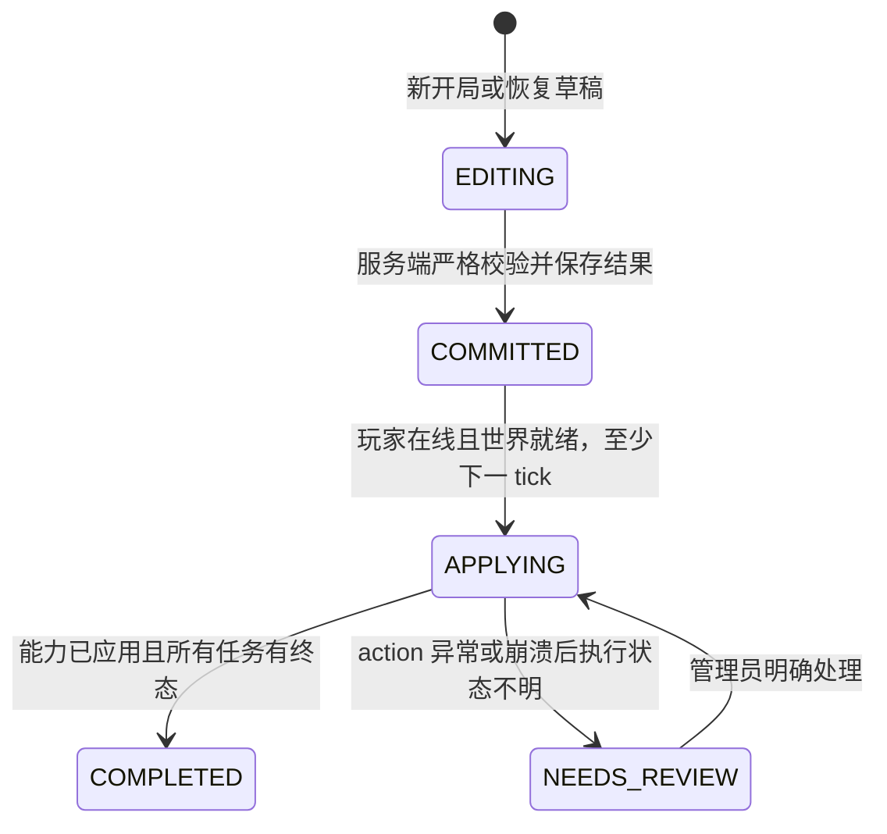

# Starting Point Buy：开局加点模组设计稿

状态：已实现（1.0.0），2026-11-10 完成审查修复和界面关闭规则调整（§15），随后拆分独立 test-mod 并扩展数据包测试（§16），代码分包与命名整理见 §17，自动名称见 §21。§14–15 保留历史记录。本文中的 `spb:*` 数据结构已经落地；`saturn:*` 接口已对照项目实际依赖的 Saturn 1.3 jar（反编译）与 26.1.2 源码确认。

目标环境：Minecraft 26.1.2、NeoForge 26.1.2.126、Java 25；模组 ID 为 `spb`。

## 1. 总体方案

整合包通过数据包定义开局方案、预设、选项组、选项、点数变化、联动条件、通过条件与最终奖励。Java 负责加载、计算、校验、存档、网络和界面，不包含具体职业、天赋、点数种类或数值平衡。

采用三层定义：

```text
Plan 开局方案
 ├─ ResourceBinding：使用哪些 Saturn resource、初始值与提交方式
 ├─ Preset：供左侧栏选择的一整套选项数量
 ├─ Group：职业、天赋、属性、缺陷……
 │   └─ Option：选中数量、资源变化、条件、最终效果
 ├─ CompletionRule：允许完成的点数和其他条件
 └─ Outcome：由最终属性或组合触发的能力和开局 action
```

所有选项统一表示为非负整数数量 `q`：未选为 `0`，选中为 `1`，可重复加点为 `0…N`。单选、多选、重复选择共用一套计算和提交机制。

核心约定：**编辑时只修改草稿；每次按完整选择集重算；确认后统一提交；ability 和开局 action 在提交后的安全时机应用。**

## 2. 六项需求对应

| 需求 | 设计 |
| --- | --- |
| 完全数据驱动，多种点数 | 数据包注册表 + Saturn `Resource` / `ResourceHolderAttachment`；每个方案可绑定任意多个 resource |
| 选项互相影响 | 条件与公式读取整个选择集，可表达折扣、互斥、前置、组合和属性门槛 |
| 单选、多选及数量联动 | Group 的 `count_mode` + `NumberProvider` 定义最少/最多数量；Option 定义自身数量限制 |
| 属性对应 ability / 开局 action | Option 和 Plan 共用 `Outcome`；按最终选择、资源和条件生成能力授予与延后任务 |
| 配置通过点数 | `completion_rules` 接收 `EntityCondition`，通过扩展比较条件支持等于、区间、多资源联合校验 |
| GUI 选择 | 主体左右分栏：左侧为窄预设栏，右侧为可纵向滚动的选项区；下部为固定点数栏、错误提示和操作按钮 |

## 3. Saturn 的复用边界

### 3.1 已有接口

| Saturn 接口 | 本模组用途 |
| --- | --- |
| `Resource`、`saturn:resource` | 点数和属性的定义、物理上下限、图标 |
| `ResourceHolderAttachment`、`copy()`、`CODEC` | 玩家资源与独立草稿资源的存储、复制、序列化 |
| `ResourceHolderAttachment.set` 与严格 NumberProvider 求值 | 初始化资源并检查定义上下限，保留公式失败 |
| `NumberProvider.CODEC` | 常量、表达式、组合数值计算；沿用 Saturn 的数据格式 |
| `FormulaContext.of(entity, extra)` | 向公式提供本次选择和资源快照变量 |
| `EntityCondition.CODEC` | 显示、可用、有效性与完成条件 |
| `EntityAction.CODEC`、`EntityActionContext` | 延后执行开局行为，并传递提交时的公式变量 |
| `CollectAbilityGrantsEvent`、`AbilityGrantService` | 根据已完成结果维护永久能力来源 |
| `IconReference` | 选项的物品图标或 GUI 纹理 |

### 3.2 必须补充的部分

- `spb:plan`、`spb:group`、`spb:option` 数据包注册表。
- 草稿、完成记录、待执行任务的本模组玩家附件。
- 求值和校验服务、提交服务、专用网络消息与 Screen。
- 一个 Saturn `EntityCondition` 扩展：`spb:compare`，比较两个 `NumberProvider`。
- 开启界面的入口：首次登录、命令，以及可供其他模组调用的 `spb:open_plan` EntityAction。

不需要再做一套 ability、action、货币或公式语言。数量和点数通过 `FormulaContext` 的显式变量表注入，无须为每个选项注册 Java 变量。

### 3.3 已确认的限制

1. `ResourceService.change()` 会截断到 resource 的物理上下限，不能用它偷偷抹去超支。Saturn 的 `ResourceTransactions.tryConsume()` 只处理正数扣取、拒绝负余额，不能直接充当带退款的整张加点表事务。
2. Saturn 默认公式读取玩家真实附件。独立草稿不会自动被 `caster_*` 资源变量看见，需要显式注入草稿变量。
3. `saturn:resource_compare` 目前表示“真实资源值 ≥ min”，不能直接表示草稿点数恰好为零。
4. Saturn `Expression.evaluate()` 出错或遇到非有限数会记录日志并返回 `0`，提交校验不能把这个 `0` 当作合法结果。
5. `EntityAction.execute()` 返回 `void`，任意 action 没有通用的事务回滚和成功凭证。
6. Saturn 使用原生数据包注册表生命周期。首版按世界加载时读取定义设计，修改后重进世界/重启服务器；不承诺 `/reload` 能刷新这些定义。

## 4. 数据定义与目录

```text
data/<namespace>/
 ├─ saturn/resource/<name>.json
 ├─ saturn/ability/<name>.json
 ├─ spb/plan/<name>.json
 ├─ spb/group/<name>.json
 ├─ spb/option/<name>.json
 ├─ tags/spb/group/<name>.json       # 可选：扩展方案中的组
 └─ tags/spb/option/<name>.json      # 可选：扩展组中的选项

assets/<namespace>/
 ├─ lang/zh_cn.json
 ├─ lang/en_us.json
 └─ textures/gui/...
```

Plan 引用 Group，Group 引用 Option；引用支持 ID 和 tag。直接引用保持列表顺序，tag 展开按 ID 排序，组内去重。同一方案内一个 Option 只能归属一个 Group，避免单选替换和数量统计出现歧义；不同方案可以复用同一 Option。

名称、描述、规则失败原因均使用 Component，支持翻译键。资源和能力使用 Holder 引用，加载时检查缺失引用。

### 4.1 Plan

| 字段 | 含义 |
| --- | --- |
| `title` | 可选的页面顶部标题；未配置时不显示，也不回退到模组名称 |
| `description` | 可选的方案说明 |
| `activation` | 是否首次登录自动开启，以及可选的适用条件、优先级 |
| `inputs` | 打开新会话时从玩家捕获的外部数值，名称映射到 NumberProvider |
| `resources` | 本方案使用的 resource 绑定列表 |
| `presets` | 左侧栏显示的预设列表，省略时为空；各项内嵌在所属 Plan 中 |
| `groups` | 按显示顺序排列的组引用 |
| `completion_rules` | 全部必须满足的完成条件，每条有稳定 ID 和失败提示 |
| `outcomes` | 按最终资源/组合判断的效果 |
| `ui` | 显示宽度、预设栏宽度、选项布局、资源栏顺序等展示设置 |

多个自动方案同时适用时，按 `priority` 降序、ID 升序串行开启；不同时编辑多个方案。默认每玩家、每世界、每 Plan 完成一次。自动入口、命令和 action 都检查同一完成记录。

ResourceBinding 包含：

| 字段 | 含义 |
| --- | --- |
| `resource` | Saturn resource ID |
| `initial` | 可选 NumberProvider；省略时读取已初始化的真实资源。仅新会话初始化一次 |
| `quantum` | 最小计量单位，默认 `1`；需要半点时可设 `0.5` |
| `commit` | `replace`：提交草稿最终值；`discard`：只在本次分配中使用，不写入真实附件 |
| `display`、`name` | 是否显示在固定资源栏及其标签 |

资源公式别名由完整 resource ID 自动生成，例如 `example:points` → `example_points`，不配置 `key`。

`initial` 不会在每次点击或重登时重复发放。`replace` 适合由本模组管理的开局点数和最终属性；建议使用独立 resource ID。共享玩法资源可作为只读 `inputs` 参与计算。

### 4.2 Group

| 字段 | 含义 |
| --- | --- |
| `title`、`description` | 标题、说明；公式别名由 Group 注册 ID 自动生成 |
| `count_mode` | 默认 `distinct`，统计选中选项种类；`total` 统计所有选项数量之和 |
| `min_count`、`max_count` | NumberProvider；最少数量默认 `0`；最多数量默认按 count_mode 计算的全部选项容量；支持整数、小数取整及公式联动 |
| `visible_condition` | 整组的显示条件 |
| `options` | 选项引用列表 |

Group 不再区分固定的单选/多选模式。`count_mode: distinct, max_count: 1` 表示最多选一种，`max_count: 2` 表示最多选两种；每种允许多少份独立由 Option 的 `hard_max` 和动态数量上限控制。`count_mode: total, max_count: 1` 则限制整个组最多一份。

新增选项时先试算候选集的组上限：若有效上限为 `1`，自动替换同组原有选项；若新项使公式上限升至 `2` 或更多，则保留原选择。已选项改数量、批量预设及上限缩小时不会擅自删项，超限草稿继续可编辑但不能确认。预览与实际编辑共用这套替换规则。

`min_count` 向上取整，`max_count` 向下取整；负数、非有限数、最少大于最多均属于配置/求值错误。必选一种为 `count_mode: distinct, min_count: 1, max_count: 1`，可选一种为 `0,1`；`max_count: 0` 只允许不选择。旧数据包需要删除 `mode`；原 `single` 组须显式设置 `max_count: 1`。

### 4.3 Option

| 字段 | 含义 |
| --- | --- |
| `name`、`description`、`icon` | 展示；公式别名由 Option 注册 ID 自动生成 |
| `hard_max` | 固定正整数上限，默认 `1`；限制网络请求及重复奖励的规模 |
| `min_count`、`max_count` | NumberProvider；选中时的最少数量与动态最多数量，默认 `1` 与 `hard_max` |
| `visible_condition` | 是否显示 |
| `enabled_condition` | 是否允许增加选择；不阻止取消 |
| `validation_rules` | 选中时必须满足的前置、互斥、组合条件及提示 |
| `resource_changes` | resource ID → NumberProvider；表示每一份选择贡献的有符号数值 |
| `outcomes` | 选中后，根据最终条件产生的效果 |

`q=0` 始终表示不选择，不要求满足该 Option 的 `min_count`；`q>0` 时才检查其最少数量。动态最多不能超过 `hard_max`，最终按两者较小值校验。

### 4.4 Outcome

Plan 与 Option 使用相同结构：

```json
{
  "key": "strong_body",
  "condition": {
    "type": "spb:compare",
    "left": "resource_example_strength",
    "operator": ">=",
    "right": 4
  },
  "abilities": ["example:strong_body"],
  "actions": [
    {
      "key": "starter_food",
      "delay": 1,
      "repeat": 1,
      "action": {
        "type": "saturn:give_item",
        "stack": {"id": "minecraft:bread", "count": 2}
      }
    }
  ]
}
```

- `condition` 省略表示通过；Option 的 Outcome 还隐含 `q>0`。
- `abilities` 是 Saturn ability 引用；首版按 ID 列表授予。
- `delay` 是 NumberProvider，默认 `1`，向上取整后至少为 `1`，表示满足执行前提后等待的在线服务端 tick；`repeat` 是 NumberProvider，默认 `1`。
- 所有 Outcome 条件、`delay` 和 `repeat` 在提交时求值并冻结；重复次数必须是非负整数且不超过任务数量上限。
- Option 选了多份不会自动重复授予相同 ability 或重复 action。需要按份执行时显式写 `repeat: "selected_<key>"`。
- 示例 ability ID 需由数据包另行定义，内容仍使用 Saturn 原格式。

### 4.5 Preset

预设内嵌在 Plan 的 `presets` 列表中，不额外增加注册表。每个预设代表一整套选项数量，由相同数据包定义：

| 字段 | 含义 |
| --- | --- |
| `name`、`description`、`icon` | 左侧列表名称、说明和可选图标 |
| `selections` | 完整 Option ID → 非负整数数量；未列出的选项按 `0` 处理 |

预设应用请求按列表位置使用自动编号 `preset_1`、`preset_2`……，不配置 `key`；重排会改变编号。

点击预设将整套数量作为一次草稿编辑应用，然后统一重算资源、联动与规则。预设不设置余额，不发放初始值，也不直接授予能力或执行 action；玩家仍需点击“确认开局”。

应用采用整体替换，避免上一个预设的选项残留。服务端先检查引用、单项硬上限及候选状态下的可用条件，再一次性替换；失败时保留原草稿。点数、组或选项的动态数量、其他完成规则不通过时，仍可保留为可编辑草稿并显示原因，不能直接完成。

手动调整后，如果当前选择集与已应用预设不同，界面标记为“自定义”；精确匹配时可显示对应预设名。预设不影响初始基准 B，反复切换与手动选出同一组合必须得到相同结果。

## 5. 点数存储与传递

### 5.1 三份数据的职责

| 数据 | 存储 | 用途 |
| --- | --- | --- |
| 玩家真实资源 | Saturn `RESOURCE_HOLDER` 附件 | 已生效的数值，由其他 Saturn 系统直接读取 |
| 会话基准与草稿资源 | 独立的 Saturn `ResourceHolderAttachment` | 保存本次分配的起点与试算结果，禁止挂到玩家真实资源位置 |
| 选择、进度、待执行任务 | 本模组附件 | 保存 Option ID → 数量、状态、定义指纹、任务凭证等非资源信息 |

数值本体使用 Saturn Holder 和 Codec；不引入一套平行的货币余额存储。中间计算可以使用临时数值集合，但资源快照和权威草稿均落入 Saturn 的 resource 容器。

新会话打开前确保所用资源已初始化，不依赖模组登录事件的偶然先后顺序。先捕获玩家资源与外部 inputs，再建立基准和草稿；断线后恢复同一草稿。

### 5.2 基准、计算值与物理上下限

对每种绑定资源：

```text
B[r] = 新会话开始时冻结的 initial 或真实资源值
R[r] = B[r] + Σ(q[o] × change[o,r](完整选择集, B, inputs))
```

每一项 `resource_changes` 是“每份贡献”。例如一项数量为 `3`、贡献为 `-2`，总贡献为 `-6`。贡献缺省为 `0`；负数为消耗，正数为返还/增加。只对 `q>0` 的选项求值并计入贡献；未选项的价格预览使用单独的候选选择集，不影响当前余额。

建议预算 resource 配置足够宽的物理区间，例如 `min=-100000, max=100000`，允许显示超支；“剩余点数必须为 0”由完成条件表达。最终属性可配置实际允许的物理区间。

先计算未经截断的 R，再检查物理上下限。越界时仍显示未经截断的候选值和错误，不能调用 `change()` 将它改成边界值后继续通过；合法时才将完整 R 写入草稿 Holder。此时不合法候选值是求值报告，不替换最后一份合法 Holder，也不能提交。

`quantum` 用于精度校验和显示。初始值及最终贡献必须能对齐到该单位，不自动四舍五入改变余额；允许的浮点误差统一为 `quantum × 1e-8`。公式自身需要取整时由作者显式使用 `floor/ceil/round`。

### 5.3 提交流程

1. 在服务端线程锁定该玩家会话，核对会话 ID、版本和定义指纹。
2. 检查 `replace` 资源的真实值是否仍等于打开时捕获的真实值。如果其他系统已经修改，返回冲突并要求刷新基准，不覆盖新值。
3. 根据服务端保存的完整选择集重新求值，严格检查全部规则和资源物理上下限。
4. 一次性准备最终资源写入、完成记录、冻结的 Outcome 和待执行任务。
5. 全部准备成功后统一提交；只更新本方案负责的 resource 条目，保留玩家的其他资源。
6. 保存并同步 `COMMITTED` 结果；之后进入延后应用阶段。

这是同一服务端线程上的逻辑事务。资源与本模组记录放在同一玩家存档中保存；不宣称玩家文件、世界文件与任意外部 action 具备跨文件的崩溃原子性。

## 6. 公式上下文与联动语义

### 6.1 变量

资源、组、选项的公式别名由完整注册 ID 自动生成：将 `:`、`/`、`-`、`.` 替换为 `_`，包含命名空间。例如 `my-pack:skills/fire.ball` → `my_pack_skills_fire_ball`。同一方案内同类别名冲突会使整个数据包注册表加载失败，不自动追加序号。`inputs` 仍使用作者配置的名称，只允许 Saturn 公式变量名支持的字母、数字和下划线；下表中除 input 外的 `<key>` 均为自动别名。

| 变量 | 值 |
| --- | --- |
| `input_<key>` | 会话开始时捕获的外部值 |
| `base_<resource_key>` | B，资源基准 |
| `selected_<option_key>` | q，选项数量 |
| `group_<group_key>_distinct` | 组内选中种类 |
| `group_<group_key>_total` | 组内选中数量之和 |
| `resource_<resource_key>` | R，完整选择集计算出的最终资源 |

例如 `selected_example_warrior`、`group_example_talents_distinct`、`base_example_points`、`resource_example_points`。

这些变量由服务端构造，客户端无法提交。嵌套 Saturn condition/action 通过原有 Context 继承变量；需要携带会话对象时使用 `spb:session` 扩展键，禁止全局“当前玩家/当前草稿”变量。

### 6.2 固定阶段，避免求值环

```text
捕获外部 inputs / 初始化 B（只在新会话执行）
  → 读取完整 q
  → 统计所有组数量
  → 计算各 Option 的 resource_changes
  → 汇总所有 R
  → 求值显示、可用、数量上限与各类校验
  → 生成 EvaluationResult
```

- `resource_changes` 允许读取 `inputs`、`base`、所有选项数量和组数量，**不能读取本轮 `resource_*`**。
- 数量上下限、条件和完成规则可以读取最终 `resource_*`。
- 两个选项可以互相影响价格，因为双方都读取已经确定的 q；不会递归计算对方的“可选性”。
- 不支持隐式的“余额决定价格、价格又决定余额”固定点求解。加载校验拒绝这种阶段依赖，并指出定义位置。

示例：

```text
弓术单价       = -3 + selected_example_warrior
天赋组最多项数 =  1 + selected_example_scholar
力量最多加点数 =  2 + 2 * selected_example_warrior
负面特质返还   = +2
```

选中战士后，弓术从 3 点变成 2 点，同时力量可加点上限增加。改选学者后，弓术恢复原价，天赋名额增加。

每次都从 B 和当前 q 重算，取消操作不使用“按现在的单价反向退款”。同一选择集必须得到相同余额，与点击历史无关。

### 6.3 比较与条件复用

`spb:compare` 注册到 Saturn 的 EntityCondition 类型注册表：

```json
{
  "type": "spb:compare",
  "left": "resource_example_points",
  "operator": "==",
  "right": 0
}
```

支持 `==`、`!=`、`<`、`<=`、`>`、`>=`（直接使用 Saturn 的 `CompareOperation` 枚举）；可选非负有限数 `epsilon`，默认绝对容差 `1e-8`。`epsilon > 0` 时比较按绝对容差放宽，`epsilon = 0` 时完全使用 `CompareOperation` 的谓词（此时 `==` 是 `Double.equals`：`-0.0 != 0.0`、`NaN == NaN`）。使用更小 quantum 的资源时，应显式设置相应容差。两侧都是 NumberProvider。与 `saturn:and/or/not`、条件列表以及 `saturn:conditional` NumberProvider 组合。

表达式沿用 exp4j 算术和 Saturn 已注册函数，不假设支持 `?:`、`&&`、`selected("id")` 等额外语法。布尔逻辑通过 EntityCondition 组合表达。

草稿规则应读取上述显式变量。直接使用 `saturn:resource_compare` 检查的是玩家真实资源，适用于外部准入条件，不适合检查未提交余额。

### 6.4 求值与错误处理

数值与条件字段直接使用 Saturn Codec，SPB 不设置 provider 白名单或确定性条件限制。数据包作者应让计价、数量限制和提交规则可重复求值；需要随机开局时，建议使用“一次抽取并持久化的 input”，避免每次点击重抽。

外部属性、等级等通过 `inputs` 捕获，编辑期不随世界时间或玩家状态漂移。最终 Outcome 的条件也基于提交快照；实际执行 action 时，普通 Saturn `caster_*` 仍表示执行当下的玩家，`resource_*` 表示冻结的开局结果。

SPB 直接调用 `NumberProvider.evaluate()`，表达式编译、嵌套 params/sum 和异常数值的回退行为遵循 Saturn。完整 Plan 的变量作用域校验仍会遍历 `constant`、`expression` 和 `sum`，但不额外检查捕获 inputs/initial 的变量。

向 SPB 抛出的求值异常、已选项的非有限贡献、非法数量范围和资源边界等仍会产生诊断并阻止提交；未选项的价格预览错误只影响展示。Saturn 内部已处理并返回回退值的公式错误不会被 SPB 重新判错。Plan 的加载期错误必须使整个数据包注册表加载失败，阻止进入存档；服务端提交入口保留 `plan.hasErrors()` 防御检查。

## 7. 草稿合法性与玩家调整

区分“编辑状态”和“可提交状态”：

- 网络编辑只接受整数 `0…hard_max`，结构性越界直接拒绝。
- 允许临时点数不足、少选、多选或前置不满足，保留草稿并显示具体错误。
- `enabled_condition=false` 时不能增加该项；始终允许减少或清空。
- 动态数量上限是提交规则，不是网络硬上限。更改职业导致名额减少时，保留原选择，提示需要移除几项。
- 已选项后来隐藏或不可用时，在“需要处理的选择”中保留一个可取消入口；不让隐藏选择继续悄悄产生收益。
- 隐藏不豁免数量规则。临时不参与的组应同时将最少数量设为 0；已选但不可用也会阻止提交。
- 单选替换是一次编辑事务，不出现先取消再选择的两次中间求值。

选项的互相前置/互斥建议写在 `validation_rules`，允许先选后修正；`enabled_condition` 用于明确的可用性控制。把相互前置都写成“未满足则禁止点击”，可能导致双方都无法先选，文档和加载诊断应提示这种配置。

默认不自动取消、不自动补选。所有变更由玩家完成，保证没有被联动规则自动替换掉的昂贵选择。

`EvaluationResult` 至少包含：候选资源值、各项贡献、显示/可用状态、组及选项数量范围、规则失败列表、配置错误、预期能力和 action 摘要、是否允许完成。

## 8. ability 与延后 action

### 8.1 状态流程



默认必须完成选择并由服务端成功接受 Submit 后才能关闭界面。`ui.allow_close_before_complete` 默认为 `false`；设为 `true` 时允许按 Esc 或“保存并关闭”保留 EDITING 草稿，下次登录或通过入口恢复。点数条件满足但尚未提交，仍不能关闭。断线始终允许且保留草稿。

打开期间服务端通过伤害/无敌判定事件忽略伤害，包括虚空，不改写玩家持久化的 invulnerable 标志。界面是否打开为连接期间的临时状态：成功提交、服务端接受 Close、管理员 unlock 或断线后解除。客户端取消未完成强制界面被其他游戏内 Screen 替换的请求，服务端也拒绝伪造的提前 Close；不阻止正常退出世界或关闭游戏。允许关闭时，客户端等待服务端确认 Close 后退出；延后任务的被动快照不会重新打开界面。

COMMITTED 之后不能通过重复发包重新编辑或再次领取；重登继续处理待执行工作。角色死亡复制附件时保留完成状态，不因死亡再次打开或发奖。

### 8.2 永久能力

- 提交时冻结最终 ability 集合；进入 APPLYING 后激活授予记录。
- 能力按 Plan 独立写入附件的 `grants` 台账；后续方案替换活动 session 时保留旧能力。旧存档从仍保留的已激活 commit 迁移，既有来源 ID 原样保留。
- 用 `CollectAbilityGrantsEvent` 贡献全部台账中的能力，并调用正常的授予重建服务；unlock 只撤销目标方案的台账。
- 来源使用 `Sources.granted(new Sources.Grant("starting_point_buy"), ...)` 生成，保证属于 Saturn 管理的 grant 来源。
- 每个 Plan/Outcome 有稳定来源标识；同一个 ability 可以有多个来源，取消本方案来源不会删除其他系统授予的同名能力。
- 不替换进程唯一的 `AbilityHooks`；不与其他依赖模组争夺全局钩子。
- 相同 ability 的重复选择不会自动叠加。多级属性可写入 Saturn resource，让能力读取实时属性；或按门槛授予不同等级的 ability。

默认授予判定在开局完成时固定；之后能力自己的 NumberProvider 可以读取实时 resource。若数据包需要“属性下降就失去能力”的动态系统，应显式接入独立的能力规则，不把它混入一次性开局发奖。

### 8.3 延后任务

开局 action 不在点击、预览或草稿恢复时执行。执行条件为：结果已提交、玩家仍在线、玩家实体和所在世界可用，且延时已到。断线暂停在线 tick 计时，重新登录并就绪后继续。

任务保存：完成批次 ID、Plan/Option/Outcome/action 稳定 key、冻结的 action 定义及资源/选择变量、剩余在线 tick、重复序号和状态。不持久化 Entity、Level 或 Java 闭包。

执行顺序为：激活能力 → 按 delay 到期时间调度 → 同 tick 按方案中的组/选项/Outcome/action 顺序执行。需要有顺序依赖的一组操作可放入同一个 Saturn sequence action；其中的执行结果不承诺可回滚。

任务状态为 `PENDING/RUNNING/DONE/FAILED/UNCERTAIN`：

- 正常重登只继续 PENDING；DONE 不重放。
- 执行抛异常记 FAILED；其他独立任务可继续，整体进入 NEEDS_REVIEW。
- 重启后残留 RUNNING 标记为 UNCERTAIN，不自动重放发物品等可能重复的副作用。
- `void` action 正常返回只能说明调用结束，不能证明内部业务成功。
- “执行完”和“存档完成”之间存在崩溃窗口，普通 action 不承诺严格 exactly-once。需要此保证的奖励应实现带任务 ID 去重、且能与效果共同持久化的幂等 action。

执行副作用前必须使用玩家存档服务同步写入 RUNNING，强制刷新文件，再读回存档核对 SPB 附件。保存失败或核对不一致则停止队列并进入 NEEDS_REVIEW；不能只调用 `setData` 就认为已持久化。动作结束后的状态也保存；纯延迟倒计时使用普通玩家自动存档。该机制是恢复协议，不能让任意 action 的世界改动成为通用持久化事务。

## 9. 完成条件

允许完成必须同时满足：

1. 所有定义、公式和引用有效。
2. 所有资源满足物理上下限、quantum 精度。
3. 所有 Group 和已选 Option 的数量范围有效。
4. 所有已选 Option 当前可用并满足 `validation_rules`。
5. 所有 `completion_rules` 通过。
6. 会话、定义版本和真实资源基准没有冲突。

常见规则：

| 要求 | 条件 |
| --- | --- |
| 点数必须正好花完 | `resource_example_points == 0` |
| 不允许透支，允许剩余 | `resource_example_points >= 0` |
| 允许剩余 0～2 点 | 两条比较：`>= 0` 和 `<= 2` |
| 两类点数都必须花完 | 分别检查 `resource_example_points == 0`、`resource_example_fate == 0` |
| 至少选一种天赋 | Group 的 `min_count=1` |
| 某组合不能同时出现 | `selected_example_a + selected_example_b <= 1` |

通过点数不是写死的全局设置，每个 Plan 可对不同 resource 分别定义规则；规则两侧都可用 NumberProvider。

## 10. GUI 方案

主体左右分栏，左侧预设栏约占主体宽度的 20%，右侧选项区约占 80%；窗口标题放在面板上方（参考 Origins 的窗口式布局），顶部不再显示方案描述，内容整体上移。底部点数、提示和按钮横跨两栏，固定不滚动；`Save & Close` 也放在底部按钮行。

```text
右侧选项区（组内网格，列数随宽度自适应）：

  职业 · 必选 1 项                                      1 / 1
  ┌──────────────────┐ ┌──────────────────┐ ┌──────────────────┐
  │ [i] 战士       □ │ │ [i] 学者       □ │ │ [i] 弓术       □ │
  │     消耗 2 点数   │ │     消耗 1 点数   │ │     消耗 2 点数   │
  └──────────────────┘ └──────────────────┘ └──────────────────┘

  属性 · 最多 4 点                                      4 / 4
  ┌──────────────────┐
  │ [i] 力量  [－] 4 [＋] │
  │     消耗 1 点数   │
  └──────────────────┘
```

交互细节：

- 左侧预设列表与右侧选项区独立滚动，滚轮仅作用于鼠标所在区域；均支持拖动滚动条和键盘导航。预设栏与选项区之间有一条纵向分隔线。
- 预设栏以短名称为主，可配图标；Tooltip 显示名称、说明和该预设的选择列表，列表最多显示前 8 项，超过则追加 `And <count> more…`。点击预设后高亮其名称，右侧同步更新完整选择和点数；手动调整后显示“自定义”。
- 右侧分组标题、选项卡片和动态说明共用纵向滚动区；切换预设时保留仍可定位的滚动锚点。
- 组内选项按网格排列，一行放多张卡片，列数按可用宽度自适应（1～3 列），卡片宽度由列数和可用宽度共同计算，因此同一列/同一行的卡片边界对齐，不再一个选项占满一整行。
- 卡片从左到右为图标槽、文字区、方形选择按钮或数量控件。文字区第一行为名称，第二行为价格（未选显示每份价格，已选显示合计），不写 `Cost`/`消耗` 前缀。所有非零资源贡献统一取相反数显示：消耗为正、返还为负，消耗项排在返还项前，同类保持资源绑定顺序。例如扣除 `1 Fate` 并增加 `2 Points` 显示为 `1 Fate, -2 Points`；选择后实际资源变化仍为 `-1 Fate, +2 Points`。Tooltip 的单价和合计使用相同符号约定；卡片空间不足时以省略号截断，完整价格在 Tooltip 查看。描述、前置、互斥、最终效果和校验原因全部放入 Tooltip，不再占用卡内空间。
- 不可重复项使用原版方形复选框；可重复项显示 `－ / 数量 / ＋`。卡片宽度变化时文字区先压缩，完整内容仍可在 Tooltip 查看。
- 视觉统一为原版风格：主面板 `popup/background`、普通/高亮/禁用按钮 `widget/button*`、方形选择 `widget/checkbox*`、图标槽 `container/slot`、滚动条 `widget/scroller*`；标题使用窗口上方的白色带阴影文本，错误/就绪使用原版红/绿。
- 单价与“再选一份造成的总差额”分开表达。价格联动时，增选还可能重算其他已选项，不能只展示本项基础消耗；悬停增减按钮可请求服务端候选试算。
- 已选高亮，不可用变暗；无效项提供文字原因和图标，不仅靠颜色区分。
- 底部固定显示所有声明为 `display=true` 的资源；多资源自动换行并保留按钮空间。小窗口时降低选项区高度，不能让底栏超出屏幕。
- 服务器返回完整失败列表；底栏显示首条及总数，点击可定位对应组/选项。
- 确认按钮仅在服务端最新状态可完成、且没有请求等待时启用；点击后进入提交中状态。
- 重置为本次会话初始草稿（全部 q=0），不会重新领取初始值，不影响已完成结果。
- 预设栏宽度通过 `ui.preset_sidebar_width` 配置，默认 `100` 个 GUI 逻辑像素，布局时限制为主体的约 20%～25%，优先保留右侧选项可读宽度。没有预设时隐藏左栏；极窄窗口可折叠为“预设”按钮打开列表。
- 分辨率和 GUI scale 改变时重新布局，保留滚动锚点和键盘焦点。

## 11. 网络、保存和定义变更

### 11.1 服务端权威

客户端只发送意图：`Open/SetQuantity/ApplyPreset/Preview/Reset/Submit/Close/Refresh`。消息携带会话 ID、客户端所知 revision，编辑时携带 Option ID 和目标整数数量；应用预设时只携带所属 Plan 内的 preset key。Refresh 只接受当前会话、当前 revision 且处于 `NEEDS_REFRESH` 的未提交草稿，旧请求及重复请求仅返回当前快照，不重建基准或重抽输入。

服务端检查玩家身份、当前会话、Option/预设是否属于当前方案及选项硬上限。组的数量限制统一由试算结果验证，选一种不再隐含每项只能一份。预设数量从服务端定义读取，批量替换只增加一次 revision。客户端不能传入最终点数、公式结果、ability ID 或 action 内容。

响应包含新 revision、完整 q、资源和规则求值结果、必要的展示数据，以及独立的 `openScreen` 标记。Close 验证会话、revision 和方案关闭配置；被动更新不打开界面，提交成功或允许关闭时由服务端释放界面。网络协议版本为 4，客户端和服务端须同时更新。三个 `spb` 数据包注册表首版不做网络同步（`dataPackRegistry(key, codec)` 不传 networkCodec）：客户端只需要渲染会话快照，专服不需要把定义下发给客户端，也不会因为客户端缺少某个 Saturn action 类型而解码失败。展示字段（标题、图标、价格、效果摘要）直接放进快照；其他模组若要在客户端使用定义，应自行在服务端逻辑中查询。这样避免“客户端必须拥有完整定义”的额外兼容要求。

同一客户端的编辑请求串行发送，服务端版本冲突返回最新快照；过期响应不覆盖较新界面。Preview 不修改草稿。提交中拒绝所有编辑请求，重复 Submit 返回同一完成批次状态。

### 11.2 存档

本模组附件保存：会话 ID、Plan ID、定义指纹、revision、状态、选择数量、最近应用的 preset key（可选）、inputs、基准/草稿 ResourceHolder、真实资源原始快照、完成结果、能力来源和任务状态。preset key 仅作展示来源，实际计算始终依据保存的完整选择集。

- 草稿断线不丢失；死亡复制附件时保留完成记录和任务凭证。
- 新会话保存初始化完成标记，避免初始化中断后重复给予初始值。
- 管理员 `unlock` 在清除目标方案记录前，把当前会话里 `commit: replace` 的资源写回会话打开时捕获的 baseline，便于重新测试；`discard` 资源、已发放物品和已执行的 action 不回滚。一次 `unlock` 只能回滚仍保存在附件里的那个会话，更早方案的基准值已经不在存档中。
- 保存与迁移使用稳定 ID，不把选项列表下标当永久标识。
- 配置移除导致未知 resource/ability ID 时，保留原始存档条目并隔离受影响会话，报告缺失 ID；不得把未知项吞成 0 或让一个引用解码失败清空整份开局记录。ResourceHolder 的 registry-aware Codec 需在兼容读取层逐条处理失败项。

### 11.3 数据包变更

定义指纹覆盖 Plan 的预设、引用的组、选项、绑定资源以及相关效果定义。重新加载世界后，旧草稿指纹不同则进入“需要刷新”状态：保留还能识别的选择，列出删除/变更项，重新建立基准与试算结果，经玩家查看后才可再次提交。

已完成的资源和奖励不因数据包更新自动重发。待执行 action 使用提交时冻结的载荷，所依赖引用缺失则暂停该任务并报告；不改为执行同 ID 的新奖励。

## 12. 连贯的数据包示例

以下是拟定 SPB 格式的示例，不代表当前模板已能加载。省略的展示字段使用默认值；引用的 ability 需另行用 Saturn 定义。

### 12.1 三种资源

`data/example/saturn/resource/points.json`：

```json
{"default_value": 8, "min": -100000, "max": 100000}
```

`data/example/saturn/resource/fate.json`：

```json
{"default_value": 2, "min": -100000, "max": 100000}
```

`data/example/saturn/resource/strength.json`：

```json
{"default_value": 0, "min": 0, "max": 100}
```

### 12.2 方案

`data/example/spb/plan/default.json`：

```json
{
  "title": {"text": "开局加点"},
  "activation": {"on_first_join": true, "priority": 0},
  "resources": [
    {"resource": "example:points", "commit": "replace", "display": true, "name": {"text": "剩余点数"}},
    {"resource": "example:fate", "commit": "replace", "display": true, "name": {"text": "命运"}},
    {"resource": "example:strength", "commit": "replace", "display": true, "name": {"text": "力量"}}
  ],
  "presets": [
    {
      "name": {"text": "战士开局"},
      "description": {"text": "战士、4 点力量与弓术"},
      "selections": {"example:warrior": 1, "example:strength": 4, "example:archery": 1}
    },
    {
      "name": {"text": "学者开局"},
      "description": {"text": "学者、2 点力量、弓术与炼金"},
      "selections": {"example:scholar": 1, "example:strength": 2, "example:archery": 1, "example:alchemy": 1}
    }
  ],
  "ui": {"preset_sidebar_width": 100, "allow_close_before_complete": false},
  "groups": ["example:profession", "example:talents", "example:attributes", "example:drawbacks"],
  "completion_rules": [
    {
      "key": "spend_all_points",
      "condition": {"type": "spb:compare", "left": "resource_example_points", "operator": "==", "right": 0},
      "message": {"text": "必须将点数恰好分配完"}
    },
    {
      "key": "nonnegative_fate",
      "condition": {"type": "spb:compare", "left": "resource_example_fate", "operator": ">=", "right": 0},
      "message": {"text": "命运不能透支"}
    }
  ],
  "outcomes": [
    {
      "key": "strong_body",
      "condition": {"type": "spb:compare", "left": "resource_example_strength", "operator": ">=", "right": 4},
      "abilities": ["example:strong_body"]
    }
  ]
}
```

### 12.3 组

`data/example/spb/group/profession.json`：

```json
{
  "title": {"text": "职业"},
  "count_mode": "distinct", "min_count": 1, "max_count": 1,
  "options": ["example:warrior", "example:scholar"]
}
```

`data/example/spb/group/talents.json`：

```json
{
  "title": {"text": "天赋"},
  "count_mode": "distinct",
  "min_count": 0, "max_count": "1 + selected_example_scholar",
  "options": ["example:archery", "example:alchemy"]
}
```

`data/example/spb/group/attributes.json`：

```json
{
  "title": {"text": "属性"},
  "count_mode": "total",
  "min_count": 0, "max_count": "2 + 2 * selected_example_warrior",
  "options": ["example:strength"]
}
```

`data/example/spb/group/drawbacks.json`：

```json
{
  "title": {"text": "缺陷"},
  "count_mode": "distinct", "min_count": 0, "max_count": 1,
  "options": ["example:indebted"]
}
```

### 12.4 选项

`data/example/spb/option/warrior.json`：

```json
{
  "name": {"text": "战士"},
  "description": {"text": "力量 +1，弓术便宜 1 点，力量最多加 4 点"},
  "resource_changes": {"example:points": -2, "example:strength": 1},
  "outcomes": [
    {
      "key": "warrior_start",
      "abilities": ["example:sword_training"],
      "actions": [
        {
          "key": "starter_food", "delay": 1,
          "action": {"type": "saturn:give_item", "stack": {"id": "minecraft:bread", "count": 2}}
        }
      ]
    }
  ]
}
```

`data/example/spb/option/scholar.json`：

```json
{
  "name": {"text": "学者"},
  "description": {"text": "额外获得 1 个天赋选择名额"},
  "resource_changes": {"example:points": -1}
}
```

`data/example/spb/option/archery.json`：

```json
{
  "name": {"text": "弓术"},
  "resource_changes": {"example:points": "-3 + selected_example_warrior", "example:fate": -1},
  "outcomes": [{"key": "archery", "abilities": ["example:archery"]}]
}
```

`data/example/spb/option/alchemy.json`：

```json
{
  "name": {"text": "炼金"},
  "resource_changes": {"example:points": -2, "example:fate": -1},
  "outcomes": [{"key": "alchemy", "abilities": ["example:alchemy"]}]
}
```

`data/example/spb/option/strength.json`：

```json
{
  "name": {"text": "力量"},
  "hard_max": 4,
  "min_count": 1, "max_count": "2 + 2 * selected_example_warrior",
  "resource_changes": {"example:points": -1, "example:strength": 1}
}
```

`data/example/spb/option/indebted.json`：

```json
{
  "name": {"text": "负债者"},
  "description": {"text": "牺牲 1 点命运，额外获得 2 点分配点数"},
  "resource_changes": {"example:points": 2, "example:fate": -1}
}
```

### 12.5 可复核的结果

选择“战士 + 力量 4 份 + 弓术”：

```text
剩余点数 = 8 - 2 - 4 + (-3 + 1) = 0
命运     = 2 - 1 = 1
力量     = 0 + 1 + 4 = 5
职业     = 1 / 1
天赋     = 1 / 1
属性加点 = 4 / 4
```

允许完成；提交后写入三个 Saturn resource，授予剑术训练、弓术和强健体魄，至少下一 tick 发放两块面包。

左侧“战士开局”预设会一次应用上述组合；“学者开局”预设对应学者、力量 2 份、弓术和炼金，结果为剩余点数 `8-1-2-3-2=0`、命运 `2-1-1=0`、力量 `2`，同样满足数量与完成规则。

在战士组合中仅将职业改为学者，保留其他选择：剩余点数仍为 `0`，但力量数量 `4` 超过新上限 `2`，因此不能完成。这说明“点数通过”和“选择数量通过”分别校验，任何一个都不能绕过另一个。

## 13. 实现划分与验证计划

建议按以下职责组织，具体类名可在实现时调整：

| 模块 | 职责 |
| --- | --- |
| `data/` | Plan、Preset、Group、Option、Outcome、规则和 Codec |
| `registry/` | 三个数据包注册表、扩展条件/action 和本模组附件 |
| `runtime/SelectionEvaluator` | 无世界副作用的完整重算，生成 EvaluationResult |
| `runtime/SelectionSessionService` | 打开、恢复、编辑、预设批量应用、预览与冲突处理 |
| `runtime/SelectionCommitService` | 严格校验和资源/结果提交 |
| `runtime/StartingOutcomeService` | 能力来源、任务调度与恢复 |
| `network/` | 客户端意图、服务端快照和提交结果 |
| `client/screen/` | 左侧预设列表、右侧选项控件、资源栏、错误定位 |

客户端类仅从客户端入口加载，专服不得初始化 Screen/render 类。

推荐实现顺序：定义和加载期校验 → 会话和资源提交 → 能力/任务恢复 → 网络 → GUI → 示例数据包。

后续实现验收重点：

- 同一选择集按不同点击顺序得到完全一致的结果；取消/重选不凭空增减点数。
- 多资源同时校验，错误资源、未知引用和公式异常都不会被静默忽略。
- 战士/学者切换正确联动价格和数量上限，既有超限选择可见且可撤销。
- 预设整体替换与手动选择结果一致；反复切换不重发点数、保留旧项或触发奖励；手动微调后正确标记“自定义”。
- 正好 0、允许非负、区间、小数 quantum 等通过规则符合定义。
- 非法请求、过期 revision、重复提交、真实资源冲突均无部分提交和重复奖励。
- 断线、死亡、重启恢复不重新初始化已保存草稿，不重放已完成任务。
- action 抛异常及模拟崩溃进入可诊断状态，不宣称任意 action exactly-once。
- 专服加载和客户端 GUI 分别验证；两栏独立滚动、窄预设栏、小窗口、不同 GUI scale、长说明和多资源显示需实际进游戏检查。

当前验证范围：已完成编译、专服启动、GameTest 和客户端 GUI 实机检查，历史结果与未覆盖项见 §14–15，拆分后的测试矩阵与验证见 §16。

## 14. 初版实现状态、最小差异与验证记录（历史）

### 14.1 实际实现结构

| 包 | 内容 |
| --- | --- |
| `com.iafenvoy.spb.data` | Plan/Group/Option/Preset/Outcome 等纯定义；`.resolution` 解析引用、tag 与指纹；`.validation` 检查 provider、变量、数量和错误路径 |
| `com.iafenvoy.spb.registry` | `SpbResourceKeys`、`SpbDatapackRegistries`、`SpbAttachments`、`SpbEntityActions`、`SpbEntityConditions`，该包保留 `Spb` 前缀；条件/action 实现在 `data.condition` / `data.action` |
| `com.iafenvoy.spb.runtime.evaluation` | `SelectionEvaluator`、`EvaluationResult`、`SelectionData`、`EvaluationSink` 及独立 ResourceView/GroupView/OptionView/OutcomePlan 等结果类型 |
| `com.iafenvoy.spb.runtime.session` | `SelectionSession`、`SessionAttachment` 保存状态；`SessionService` 是生命周期与请求入口；包内 `SessionEditor` 处理编辑/预览和共用校验，`SessionResources` 负责资源捕获/物化/写入/回滚，`SessionCommit` 冻结奖励并提交，`SessionStorage` 校验落盘检查点，`SessionSync` 发送快照；其余为状态、持久化记录、打开来源和检查点异常 |
| `com.iafenvoy.spb.runtime.outcome` | `OutcomeService`、`FrozenTask`、`FrozenGrant`、`TaskState` |
| `com.iafenvoy.spb.testmod`（独立 `src/testMod`） | `StartingPointBuyTest`、`SelectionGameTests`、`RegressionTests`、`ScreenLayoutTests`、`GeneratedKeyTests`、`DatapackTests`、`TestPlayers`、`CheckpointObserver`；当前共 137 个 GameTest，见 §16 |
| `com.iafenvoy.spb.network` | `NetworkManager` 注册协议，`SnapshotFactory` 投影求值结果，`ClientNetworkHandler` / `ServerNetworkHandler` 处理消息；`.model` 纯协议模型，`.payload` 三个消息封装 |
| `com.iafenvoy.spb.util` | `DefinitionNames`、`DefinitionCodecs` |
| `com.iafenvoy.spb.command` / `.event` | `/spb` 命令、登录/每个玩家 tick/`CollectAbilityGrantsEvent` 入口 |
| `com.iafenvoy.spb` / `.screen` | `StartingPointBuyClient`（仅 `Dist.CLIENT` 的 payload 注册与开屏拦截）与 `PlanScreen`（左右分栏、两栏独立滚动、Tooltip、预览） |

### 14.2 与设计稿的最小差异

1. **三个 `spb` 注册表不同步**：`dataPackRegistry(key, codec)` 不提供 network codec。客户端只渲染服务端快照，快照携带标题、图标、价格、效果摘要等展示字段。这样专服不依赖客户端安装完整定义，也避免客户端缺少某个 Saturn action 类型时整份定义解码失败。其他模组若需要客户端定义，应自行同步或在服务端查询。
2. **NumberProvider 直接复用 Saturn**：所有数值字段使用 Saturn `NumberProvider.CODEC`，运行时直接调用 `evaluate()`，表达式解码及异常数值的回退行为遵循 Saturn。SPB 已移除 provider 白名单、严格求值层、捕获变量检查及确定性条件限制。`inputs` 和 `initial` 在会话开始时捕获并持久化；刷新时重捕获 inputs、读取当前真实资源。完整方案的变量作用域检查仍覆盖 `constant`、`expression` 和 `sum`，包括嵌套 params。
3. **变量阶段**：`resource_changes` 只能读 `input_*`/`base_*`/`selected_*`/`group_*`；数量上下限、条件、完成规则和 outcome 可读 `resource_*`。在 `resource_changes` 中读取 `resource_*` 是加载错误。`PlanValidator` 在全部注册表及 tag 冻结后执行这项检查，错误会阻止世界加载。
4. **刷新语义**：定义指纹或真实资源变化使未提交草稿进入 `NEEDS_REFRESH`。此时底部“重置”切换为“刷新草稿”，在当前界面内恢复编辑，无需关闭；强制完成与打开期间免伤继续生效。该状态使用只读的草稿快照，保留真实数量控件和动态限制。刷新保留仍能识别的选择，重新捕获 inputs 和真实资源基准，**所有绑定都读取当前真实值，不会重新求值 `initial`**，避免重复发放初始点数。`/starting_point_buy refresh` 和重新打开也可以重建基准。已提交/完成的会话禁止 refresh，提交入口也检查 commit 和完成记录。
5. **草稿资源持久化**：会话附件以 `Identifier + double` 列表保存基准/草稿/已提交值，而不是直接持久化 `ResourceHolderAttachment` 的 registry-aware codec。这样删除 resource 不会让整份附件解码失败；未知 id 保留并报告。每次求值和提交都把值物化进 `ResourceHolderAttachment`，再读回权威值写入附件。只有全部绑定资源都合法时才更新草稿 Holder。
6. **延迟任务载荷**：提交时用 `EntityAction.CODEC` 把 action 编码成 NBT 冻结。执行前 `RUNNING` + 保存，执行时再解码；解码失败记 `FAILED` 并进入 `NEEDS_REVIEW`，不会让整份附件解码失败，也不会换成同 ID 的新奖励。重启后残留的 `RUNNING` 转为 `UNCERTAIN`，不自动重放。
7. **能力来源**：`Sources.granted(new Grant("starting_point_buy"), Identifier.fromNamespaceAndPath("spb", "<plan_namespace>/<plan_path>/<scope>/<outcome>"))`，即 `saturn:grant/starting_point_buy/spb/...`。每个 Plan/Option/Outcome 一个稳定来源；路径经过 sanitize，冲突时追加序号。
8. **UI 字段**：新增 `ui.max_width`、`ui.max_height`（默认 `0`、`0`，表示直接使用当前 GUI 逻辑屏幕尺寸；正数才是固定窗口上限）。预设栏实际宽度取 `max(preset_sidebar_width, 主体 20%)` 并限制在主体 25% 以内；窄于 56 逻辑像素或没有预设时隐藏左栏。
9. **`spb:compare`**：操作符直接复用 Saturn 的 `CompareOperation`，`epsilon` 由本模组实现，因为 Saturn 的枚举没有容差：`epsilon > 0` 时按绝对容差放宽比较，`epsilon = 0` 时完全走 `CompareOperation` 的谓词（`==` 为 `Double.equals`）。默认 `epsilon=1e-8`，`<`/`>` 也按容差比较。
10. **示例数据**：`particle_color` 使用 API 要求的 `#RRGGBB` 形式；示例命名空间为 `example`，简体/繁体以外的语言回退到英文键。
11. **预设与组**：预设按列表位置自动编号；Group 无 `mode` 字段，`count_mode` 默认 `distinct`，`min_count` / `max_count` 统一决定数量限制。

### 14.3 初版验证记录（拆分前）

**构建**：`gradlew build`（NeoForge 26.1.2.126、Java 25、Saturn 1.2.6）通过。

**专服**：`gradlew runServer` 成功加载 26.1.2.126 专服、Saturn 1.2.6 与 `example` 示例数据包（`example:default` 的 resource/group/option/ability 引用全部解析成功，无注册表加载错误）。专服启动扫描列表不包含任何客户端类（见下）。

**GameTests**：`gradlew runGameTestServer` 以无窗口方式运行 `spb:*` 的 10 个测试。`build.gradle` 的 `gameTestServer` 配置加了 `--tests spb:*`，因为 Saturn 发布 jar 自带的 `saturn:information/expressions` 测试在 1.2.6 下会失败（与本模组无关）。实测输出：

```text
Each test that matches spb:* will be run 1 times (total: 10)
========= 10 GAME TESTS COMPLETE IN 682.0 ms ======================
All 10 required tests passed :)
BUILD SUCCESSFUL
```

测试名单与断言：

- `example_warrior`：战士选择点数 0、命运 1、力量 5，可完成；力量上限 4；授予剑术训练/弓术/强健体魄；冻结 starter_food action。
- `example_scholar`：学者选择点数 0、命运 0、力量 2，可完成；力量上限 2；天赋名额 2。
- `dynamic_limit`：战士选择保留力量 4 改学者后点数仍为 0，但力量上限变为 2 并阻止完成。
- `multi_resource`：负债者使点数 2、命运 0；点数规则失败，命运非负规则通过。
- `presets`：两个预设都能完成、与手动同一数量表一致、来回切换恢复同样的变量。
- `order_independence`：反向插入顺序得到完全相同的变量、资源和 `canComplete`。
- `definition_phase`：在 `resource_changes` 中读取 `resource_*` 被加载校验拒绝。
- `compare_epsilon`：1e-10 视为相等，1e-6 视为不等。
- `persistence_roundtrip`：会话选择、草稿和冻结 action NBT 的附件编解码往返。
- `snapshot_roundtrip`：客户端快照 Codec 往返（图标、Component、选项与资源行）。

**客户端 GUI**：`gradlew runClient` 使用测试世界的快速进入，服务端自动打开方案；实机截图与日志验证：

- 初始界面（旧版实机截图）：左窄预设栏（两个预设 + 图标）、右侧职业/天赋/属性/缺陷分组与选项；旧版选项行为行内描述 + 单选/复选标记 + 右侧价格。底部点数/命运/力量、校验原因、重置/确认按钮固定；右侧可滚动。
- 当前布局：选项区为组内多列卡片网格（列数按可用宽度自适应 1～3），卡片为图标槽 + 名称/价格两行 + 原版方形复选框（可重复项为 `－/数量/＋`）；顶部方案描述已移除，内容整体上移，标题仍在面板上方；预设栏右侧有纵向分隔线；`Save & Close` 移到底部按钮行（重置左侧）。面板尺寸直接取 `Screen.width/height`（已是 GUI 逻辑像素）减边距；`ui.max_width/max_height` 为 `0` 时铺满逻辑屏幕，正数才作为固定窗口上限。视觉为原版精灵（`popup/background`、`widget/button*`、`widget/checkbox*`、`container/slot`、`widget/scroller*`）。本次只完成编译与 `build`，未重新启动客户端截图，布局和点击区域需在客户端复核。
- 历史记录（已被 §15 修复替代）：求值改为直接调用 `NumberProvider.evaluate()`（删除 SPB 的严格求值层）后再次运行 `gradlew runGameTestServer`：10/10 通过（`10 GAME TESTS COMPLETE`），示例数据（`ui.max_width/max_height=0`，直接使用逻辑屏幕）仍可加载并完成战士/学者流程。
- 点击预设：整体替换选择并重算；截图中学者预设使点数/命运/力量变为 0/0/2，属性显示 2/2，确认按钮启用；手动保留力量 4 改职业时显示超过上限的红色原因（动态上限）。
- 提交：服务端日志 `Committed starting-point session ...: 3 grants, 0 tasks`（学者预设），随后输出 `Starting point 'example:default' completed`；资源和能力来源写入，普通 action 任务按计划调度。
- 重复提交：`COMMITTED/APPLYING/COMPLETED` 状态下界面只读，服务端 `requireEditable` 对非 `EDITING` 状态直接回送当前快照。
- 键盘快捷键（`1..9` 应用预设、方向键移动焦点、`Enter` 切换、`Ctrl+Enter` 确认）已实现；本次自动化键盘输入受窗口焦点限制，未作为验收依据，需手动复核。

截图在验证时生成于测试运行目录，已从工作区清理，不随仓库提交。

**专服不加载客户端类**：专服启动日志的 `AutomaticEventSubscriber` 扫描列表只包含 `SpbCommands`、`SpbServerEvents`、`NetworkManager`、`SpbDatapackRegistries`，没有 `ClientNetworkHandler` 与 `PlanScreen`；`NetworkManager` 只注册 server 侧 handler 和 client payload 类型，客户端 handler 通过 `RegisterClientPayloadHandlersEvent` 在 `Dist.CLIENT` 类中挂接。

### 14.4 仍未覆盖/已知限制

- 未做多人联机、断线重连、死亡复制、真实资源冲突、管理员 `/starting_point_buy recover` 的实机回归；这些路径按 §8、§11 的状态机实现，但只在代码层保证。
- 未验证极端窗口尺寸、非默认 GUI scale、超长 Tooltip 的像素级效果；已用 900×600（GUI scale 2）验证两栏滚动和底部固定栏。
- 任意 Saturn action 没有通用 exactly-once；`RUNNING`→`UNCERTAIN` 只是恢复协议，不重放。需要精确一次的奖励应实现按任务 ID 幂等的 action。
- 修改数据包后仍需重进世界/重启服务器；不承诺 `/reload` 刷新 `spb` 定义。
- 历史实现依赖 `ResourceService.initialize` 初始化真实资源；§15 修复后先严格求值资源默认值/上下限，再通过 Saturn Holder 写入，避免初始化公式失败被吞成 0。


## 15. 2026-11-10 审查修复与交互规则调整（拆分前记录）

- 修复审查的 7 项问题：refresh/提交不能重放奖励；永久能力独立按方案保存；公式失败阻止完成；定义错误参与提交校验；延后动作有实际落盘检查点；Identifier 翻译参数统一转字符串；预设使用严格非负整数 Codec，再转换为 fastutil map。
- 新增 `ui.allow_close_before_complete`（默认 `false`），左右分栏布局继续保留。服务端成功提交前禁止 Esc、保存并关闭，以及其他游戏内界面替换；配置为 `true` 时可以保存草稿后关闭。
- 打开期间服务端忽略伤害；成功提交、允许关闭、管理员解锁或断线解除。临时打开状态不持久化，不改玩家原有无敌能力。
- 当时 `build` 和 21 个服务端 GameTest 通过，含 11 个新增回归测试。覆盖普通、火焰、摔落、饥饿、虚空伤害；关闭与提交后的免疫解除；真实存档 RUNNING/DONE 检查点；保存内容不匹配时不发奖；中断任务不重放。旧 §14.3 中的 10 项为历史基线。
- 验证命令（使用本机已缓存游戏资源）：`gradlew.bat build runGameTestServer -x downloadAssets --no-configuration-cache -Dorg.gradle.java.installations.auto-download=false --console=plain`。日志为 `build/fix-verification.log`。
- 旧版本已被覆盖且没有留下 commit 的历史能力无法凭空恢复；仍保留的当前 commit 会自动迁移。任意 Saturn action 仍没有通用 exactly-once 保证。

客户端验证：使用 `build/client-smoke.init.gradle` 加载仅存在于 build 目录的游戏内测试，在独立世界副本运行真实客户端，日志 `build/client-smoke.log` 输出 `UI_SMOKE_PASS`。验证默认 Esc/onClose 拦截、背包界面替换拦截、已满足点数条件但尚未提交仍锁定、成功提交后关闭、可选关闭等待服务端确认，以及两条路径的免疫解除。1280×800 实际渲染截图位于 `build/client-smoke-run/screenshots/spb-locked.png`、`spb-ready-locked.png`、`spb-optional.png`，已检查按钮禁用/启用状态及左右分栏。极端 GUI scale 本次未遍历。临时测试代码不进入正式 jar。

## 16. 独立测试模组与数据包矩阵

### 16.1 构建与装载隔离

采用同一 Gradle 项目内的独立 `testMod` source set，模组 ID 为 `spb_test`，有单独入口和 `neoforge.mods.toml`，依赖正式模组 `spb` 与 Saturn。`StartingPointBuy` 不再注册测试。

| 目录/产物 | 内容 |
| --- | --- |
| `src/main` → `spb-1.0.0.jar` | 正式模组逻辑、通用 GUI 翻译与元数据 |
| `src/testMod/java/com/iafenvoy/spb/testmod` | 测试模组入口、22 个示例与回归测试、4 个界面布局测试、4 个自动名称测试、JSON fixture 驱动器 |
| `src/testMod/resources/data/example` | 原连贯示例，包含资源、能力、职业、预设与延后奖励 |
| `src/testMod/resources/data/spb_test` | 新增 14 套方案、共享组/选项、Saturn 资源/能力、tag 与测试结构 |
| `src/testMod/resources/fixtures` | 求值输入/预期、方案清单、故意无效的定义 |
| `spb-1.0.0-test-mod.jar` | 上述测试代码、示例翻译和全部测试资源 |

`build` 同时产出两个 jar。`check` 依赖 `verifyTestModIsolation`，检查正式 jar 不包含测试类、fixture、`data/example` 或 `data/spb_test`，并检查 test-mod 的必要条目。正式 `runClient`、`runServer` 与 datagen 只装载 `spb`；`runTestClient`、`runTestServer`、`runGameTestServer` 才额外装载 `spb_test`。后三者分别使用独立运行目录，避免污染正式开发世界。

### 16.2 数据覆盖

有效 JSON 经 Minecraft 数据包注册表实际加载，而不是在测试中手造 Java 定义。14 套新增方案分别覆盖联动、多选计数、取整、小数精度、隐藏与前置、余额区间、物理边界、公式组合、运行时错误、tag、奖励、可选关闭和草稿专用资源。完整对应表及手动复核步骤见 [`src/testMod/README.zh-CN.md`](../src/testMod/README.zh-CN.md)。

测试总数为 **137**：

- 22 项示例与回归测试；
- `fixtures/evaluations.json` 中 51 项选择集求值用例；
- 25 份无效 Plan/Group/Option，检查 Codec 解码或语义校验失败，并验证错误字段路径与禁止提交；
- 26 项实际注册表加载测试：25 份无效定义逐个注入独立 ResourceManager，要求加载 Future 失败；1 项有效对照要求成功；
- 1 项 registry/preset 合同测试，遍历方案清单并检查所有预设可完成；
- 4 项真实服务端会话测试：可选关闭与 revision、单选替换与动态超限、input 捕获/reset/`discard` 提交、延后奖励与重复提交。
- 4 项界面布局测试：多列导航与命中、隐藏已选项、窄屏弹层与尺寸上限、独立滚动与拖动边界；专服运行时不加载客户端类。

- 4 项自动名称测试：Codec 无手写 key、实际公式变量、资源/组重排稳定性、预设编号及查找/匹配一致性。三类别名冲突另由上述 25 份无效定义和实际加载测试覆盖。

故意无效的 JSON 放在 `fixtures/invalid`，测试时通过内存资源覆盖逐个交给 Minecraft 注册表加载器，验证失败而不污染运行中世界。保留 `syntax_typed`，验证 Saturn 显式 `saturn:expression` Codec 自身的语法错误；已删除 SPB 额外表达式校验和严格求值对应的旧测试及 fixture。未被 Plan 引用的坏 Group/Option 也必须拒绝加载。

服务端测试统一通过 `TestPlayers` 创建独立 UUID 的 NeoForge `FakePlayer`，不加入在线玩家列表，关闭其默认无敌状态并标记客户端已加载。延后奖励测试使用真实服务器时间与注册的 `PlayerTickEvent.Post` 监听器；FakePlayer 的空连接不驱动玩家 tick，因此由 GameTest 每 tick 发布事件。任务仍经过真实提交、落盘和 action 执行。

### 16.3 验证与复跑

`gradlew.bat build runGameTestServer -x downloadAssets --no-configuration-cache -Dorg.gradle.java.installations.auto-download=false --console=plain` 已通过，使用本机缓存资源，最新日志为 `build/auto-key-verification.log`：

```text
137 GAME TESTS COMPLETE
All 137 required tests passed :)
BUILD SUCCESSFUL
```

一般环境可直接运行 `gradlew runGameTestServer`。测试筛选为 `spb_test:*`，保留对 Saturn 发布包自带测试的隔离。`build` 只构建和检查打包隔离，GameTest 需要单独执行。

手动测试运行 `gradlew runTestClient`，在测试世界使用 `/starting_point_buy open spb_test:<plan>`；`/starting_point_buy unlock <player> <plan>` 可清理完成记录后重试。专服入口为 `gradlew runTestServer`。正式部署只安装主 jar 和依赖，示例仅在额外安装 test-mod 时存在。

拆分后已运行真实客户端，使用仅注入 `testMod` source set 的临时探针与独立世界副本，日志 `build/test-mod-client-smoke.log` 输出 `UI_SMOKE_PASS`。验证 `example:default` 提交前关闭锁定、提交后关闭及免疫解除；真实 JSON `spb_test:optional` 的 Esc 保存关闭；`spb_test:linked` 的左右两栏、两预设、三资源、Sword 归零、切换 Sage 保留 train×4 并因上限 2 禁止确认，应用 Sage 预设后成功提交。1280×800 截图位于 `build/client-smoke-run/screenshots/spb-test-linked.png` 与 `spb-test-linked-invalid.png`，已检查布局和确认按钮状态。临时探针及世界均位于 `build`，不进入任何发布 jar；极端窗口/GUI scale 仍未遍历。

另外使用默认启用 configuration cache 的 `gradlew build` 验证构建与打包隔离通过，日志 `build/test-mod-package-verification.log`。

## 17. 包结构与命名整理

`registry` 包保留 `Spb` 前缀，其余类按实际职责命名。`SpbSessions` / `SpbSession` / `SpbAttachment` 对应 `SessionService` / `SelectionSession` / `SessionAttachment`，`SpbOutcomes` 对应 `OutcomeService`。测试入口改为 `StartingPointBuyTest`。

```text
com.iafenvoy.spb
├─ data                   数据包定义与 Codec
│  ├─ action / condition  Saturn 扩展实现
│  ├─ resolution          PlanIndex、ResolvedPlan/Group/Option、Fingerprint
│  └─ validation          PlanValidator、DatapackValidator、VariableScope、Issue/IssueSeverity
├─ registry               SpbResourceKeys / SpbDatapackRegistries / SpbAttachments / SpbEntity*
├─ runtime
│  ├─ evaluation          求值器、上下文诊断、输入与独立结果记录
│  ├─ session             会话生命周期、状态、存档与检查点
│  └─ outcome             已冻结的能力、任务和延后执行服务
├─ network
│  ├─ model               SelectionIntent / SelectionSnapshot / SelectionPreview 及展示行
│  ├─ payload             IntentC2SPayload / SnapshotS2CPayload / PreviewS2CPayload
│  └─ NetworkManager / SnapshotFactory / ServerNetworkHandler / ClientNetworkHandler
├─ screen
│  ├─ PlanScreen          生命周期与事件分发
│  ├─ PlanRequests        请求等待、快照与预览匹配
│  ├─ OptionPanel / PresetPanel / PlanFooter
│  ├─ ScreenDrawing / ScreenText
│  ├─ layout              PlanScreenLayout / OptionGrid / LayoutEntry / QuantityControls / ScreenRectangle
│  └─ widget              ScrollArea
├─ util                   DefinitionNames / DefinitionCodecs
└─ command / event        AllocationCommands / PlayerSessionEvents
```

`SnapshotFactory` 只把服务端求值结果转换成协议模型；服务端会话入口检查通道并发送快照/预览；`ClientNetworkHandler` 负责客户端收包及发送意图，界面不构造 payload。服务端注册路径不引用客户端处理器或 Screen，客户端 handler 仍只从 `StartingPointBuyClient` 入口注册。

原 `SpbSnapshot` 的展示行、`EvaluationResult` 的结果记录、`ResolvedPlan` 的解析项，以及诊断器、检查点异常、打开来源、GUI 布局类型和测试存档观察器均已提为独立顶层类型。重复的 UiLine 已合并为不可变 `UiSettings`，保留相同的 Codec 字段和默认值。

本次为结构整理：数据包命名空间、注册 ID、附件与任务存档字段、payload ID、协议版本和计算/提交规则保持不变。原有 92 项 GameTest 继续作为行为回归基线，打包隔离检查同步跟随测试入口新类名。

## 18. 加载失败保护与 Codec 校验

加载错误必须阻止进入存档，不能只在 GUI 中提示并禁止确认。Codec 返回错误、Holder 缺失以及跨定义语义错误都会让 Minecraft 的注册表加载 Future 失败，进入原版的数据包加载失败路径。warning 仍可加载；玩家临时超支、数量超限等依赖选择状态的问题由运行时报告。公式求值直接遵循 Saturn；Saturn 内部处理的异常值不再由 SPB 严格求值层重新判错。

### 18.1 校验职责

| 阶段 | 实现 | 检查内容 |
| --- | --- | --- |
| 解码与编码 | `DefinitionCodecs` 及各定义 Codec | input 名称、非空规则 key、有限正 quantum、正 hard_max、非负预设数量、重复资源、资源别名冲突、outcome/action 唯一性；数值与条件解码复用 Saturn Codec |
| 注册表冻结 | 原版 Holder 绑定 | 所有直接引用必须存在，包括未使用的 Group/Option 引用的资源、选项和能力 |
| 全部注册表及 tag 冻结后 | `RegistryDataLoaderMixin` → `DatapackValidator` | 使用冻结后的完整注册表解析全部方案；检查 tag 存在、选项归属、资源绑定、预设成员/数量、完整变量作用域；同时检查未被方案引用的组 |
| 玩家操作时 | `SelectionEvaluator` / `EvaluationDiagnostics` | 当前选择集的动态数量、点数、前置、完成条件及未被 Saturn 内部处理的求值异常；允许保留暂不合法的草稿 |

原 `DefinitionValidator` 的静态规则已下沉到 Codec，剩余类改名为 `PlanValidator`，只负责完整方案的公式变量作用域。Option 可以跨 Plan 复用，其 Codec 不能绑定某个方案的 `selected_*` / `group_*` / `resource_*` 集合。跨定义错误保留 Issue 路径和参数，汇总后使注册表加载失败。校验挂在资源注册表加载 Future 的完成链上，在世界加载前运行，不依赖服务器启动事件。

### 18.2 引用类型

- `EntryRef<T>` 使用自定义 `Either<Holder<T>, TagKey<T>>`，分别用于 Plan 的组和 Group 的选项。保持 `"namespace:id"` 与 `"#namespace:tag"` 混合列表格式；按条目顺序展开，tag 成员按 ID 排序，全程去重。
- `ResourceBinding.resource` 和 `Option.resource_changes` 的键使用 Saturn `Holder<Resource>`；`Outcome.abilities` 使用 `Holder<Ability>`，复用 Saturn 的固定注册表 Codec。JSON 仍为原有 ID 字符串。
- tag 引用缺失为 error；存在的空 tag 可以加载并给出空组提示。tag 的成员解析失败导致该 tag 不存在时，同样拒绝引用它的方案/组。
- 预设 selections 保留 ID，按所属 Plan 进行成员校验。存档、网络及冻结后的资源/能力/任务记录也保留稳定 ID；定义改为 Holder 不改变持久化字段或网络协议。
- `OpenPlanAction.plan` 使用可选 `Holder<Plan>`，缺省走 `SessionService.openCurrentOrAutomatic`，指定时走 `open(player, holder)`；不存在的方案引用使数据包注册表加载失败。指定解锁走 `unlock(player, holder)`，全部解锁独立为 `unlockAll(player)`，不再用 `null` 表达操作范围。命令直接传递 `ResourceArgument` 得到的 Holder，JSON 方案引用仍是 ID 字符串。
- `SessionAttachment.completions`、`grants` 的键改为 `Holder<Plan>`，通过 Saturn `CollectionCodecs.map(Plan.CODEC, ...)` 读取。丢失的方案 Holder 或解码失败的记录只丢弃对应条目，有效条目和当前会话不受影响；保存仍使用原有的 ID 字符串键。当前会话及冻结任务继续保留稳定 ID，旧版永久能力记录在首次收集能力或替换会话时，借助当前注册表迁移，缺失方案不重新插回账本。

### 18.3 验证

历史日志 `build/codec-verification.log` 记录当时 140/140 GameTest 通过及构建成功，包含现已移除的额外公式校验。当前 `build/plan-title-verification.log` 记录 127/127 GameTest 通过及构建成功，其中 25 份坏定义逐一验证真实加载 Future 失败。保留检查包含未知资源/能力/组/选项、缺失 tag、重复 key、未使用的非法组/选项、显式表达式 Codec 语法错误、方案变量作用域与非法预设。

专服负向实机验证分别使用独立 `build/invalid-load-codec` 和 `build/invalid-load-semantic` 运行目录：非法 schema 与未知完成条件变量均触发 `Failed to load datapacks, can't proceed with server load`，世界未产生 `level.dat` 或 region。日志分别为 `build/invalid-load-codec.log` 和 `build/invalid-load-semantic.log`。测试同时发现并修复公共网络注册提前加载客户端 GUI 的问题：客户端处理器移至 `StartingPointBuyClient` 的 `RegisterClientPayloadHandlersEvent`，公共注册仅引用 payload 类型与服务端处理器，继续使用默认主线程调度。

最新客户端回归日志 `build/codec-client-smoke.log` 输出 `UI_SMOKE_PASS`：确认 Holder/Codec 调整和客户端处理器注册后，默认关闭锁定、提交解除免疫、可选关闭回执、预设、三资源联动和动态数量上限仍正常。

## 19. Plan 标题与版本字段调整

Plan 已移除数据格式版本字段。`title` 为可选 Component，直接用作选点界面顶部标题及旁白标题；未配置时不绘制标题，也不回退到模组名称。网络快照同样使用可选 title；协议版本更新为 2，客户端和服务端需同时更新。`spb_test:optional` 作为无标题数据包示例；原 schema 无效 fixture 替换为标题类型错误 fixture。

同步删除已移除功能对应的 13 项旧测试：严格公式求值回归、选中除零/溢出时强制拒绝提交，以及简写/嵌套语法、捕获变量、provider 白名单和嵌套随机条件限制对应的解码/实际加载用例。当前 127 项测试全部通过，见 `build/plan-title-verification.log`；标题快照往返及真实数据包的有标题/无标题定义均已覆盖。客户端日志 `build/plan-title-client-smoke.log` 输出 `UI_SMOKE_PASS`，检查无标题时不显示顶部标题、切换方案后使用新标题，以及关闭锁定、免伤解除、预设与动态上限。

清理编译/资源输出后重新构建，确认发布 jar 不包含已删除的 fixture 或 `StrictNumbers` 类。修复 test-mod 版本号展开在任务执行时访问 `project` 的配置缓存兼容问题；IDE 构建和启用配置缓存的 `build` 均通过，后者日志为 `build/plan-title-package-verification.log`。

## 20. PlanScreen 职责拆分

`PlanScreen` 只协调生命周期、关闭规则和事件路由；预设、选项和页脚分别由 `PresetPanel`、`OptionPanel`、`PlanFooter` 管理。`PlanRequests` 统一快照、等待超时、提交/预设/数量请求和预览回包匹配；`ScreenDrawing` 复用原版精灵，`ScreenText` 负责价格、资源和 Tooltip 文本。以上均为独立顶层类，区域通过组合工作。

主面板和窄屏预设弹层使用独立的 `assets/spb/textures/gui/sprites/panel/stone.png` 石质背景贴图。边框和石纹保存在同一张 PNG 中，配套 `.png.mcmeta` 使用九宫格：四像素边框固定，中央 64×64 石纹按原尺寸平铺，不拉伸纹理。运行时只绘制精灵，资源包可覆盖这两个文件来更换背景。

`PlanScreenLayout` 集中固定区域坐标，`OptionGrid` 按组索引选项后生成含矩形边界的 `LayoutEntry`，替换平行坐标数组；绘制、命中和键盘导航共用同一份几何数据。`ScrollArea` 统一两栏滚动、拖动、限位与焦点滚入；快照更新和窗口调整保留首个可见选项的锚点。资源换行只在布局更新时计算，渲染和 Tooltip 命中复用结果。

同时修复预设列表滚动后标题误触行、滚动条在视口外误命中，以及无关预览回包覆盖当前悬停预览的问题。预设标题独立裁剪；离开控件、编辑、滚动或更新快照会清除旧预览。

验证：IDE 构建、打包隔离及 133 项 GameTest 通过，服务端日志 `build/plan-screen-verification.log`。真实客户端日志 `build/plan-screen-client-smoke.log` 输出 `UI_SMOKE_PASS`，覆盖有/无标题、强制/可选关闭、免疫解除、预设键盘/鼠标操作、角色替换、数量加减、预览匹配、双栏滚动/拖动、上下方向键、Page Down、锚点保留、窄屏弹层及确认提交。原版界面截图已检查；压力布局使用临时快照，不写入数据包或发布产物。


## 21. 自动生成公式别名与预设编号

ResourceBinding、Group、Option、Preset 已移除手写 `key` 字段和相应构造参数，不保留覆盖选项。资源、组、选项使用完整注册 ID 生成公式别名：把 `:`、`/`、`-`、`.` 替换为 `_`，其余合法 ID 字符保留。例如 `example:warrior` → `example_warrior` → `selected_example_warrior`，`example:points` → `base_example_points` / `resource_example_points`，`example:profession` → `group_example_profession_distinct` / `group_example_profession_total`。

别名不受资源、组和选项的列表顺序影响，命名空间也参与生成。同一方案内同类定义转换后冲突属于加载错误，例如 `example:a-b` 与 `example:a_b`；资源在 Plan Codec 检查，组和选项在引用解析后检查，未被方案使用的组同样检查其选项。错误会使整个注册表加载 Future 失败，保护存档；不按加载顺序追加后缀。

预设内嵌在 Plan 中，按列表位置自动编号 `preset_1`、`preset_2`……，应用请求、自动匹配、编辑/终态快照统一使用该编号。相同选择内容允许出现多份预设；重排预设会改变编号。保存的完整选择集仍是计算依据，编号只表示来源。

`inputs` 是具名数值映射，保留作者提供的名称，Codec 检查名称能够组成合法 Saturn 变量 `input_<name>`。Outcome、OutcomeAction、CompletionRule、ValidationRule 的稳定 `key` 用于奖励来源、延后任务与诊断，仍保留配置；它们不属于旧 `DefinitionCodecs.KEY` 的公式别名。

这是数据格式变更，数据包中的公式须改用完整 ID 生成的名字。旧 `key` 字段不再被 Codec 读取或编码，也不会重命名自动别名；Saturn 解码行为之外，方案作用域检查会拒绝未知旧变量。资源/选项的存档 ID 和网络字段类型保持不变，协议仍为 2。尚未提交会话遇到新定义指纹会要求刷新，继续保留可识别的选择；已提交任务继续使用冻结 action 载荷及变量快照。

所有示例与 fixture 已迁移。新增 4 项自动名称 GameTest，替换三份过时的手写 key 错误 fixture 为资源/组/选项别名冲突；总计 137 项测试。验证记录见 `build/auto-key-verification.log`，真实客户端回归见 `build/auto-key-client-smoke.log`。§14–15、§19–20 的旧测试数量和日志保留为当时记录。

## 22. 统一组选择数量限制

移除 `GroupMode` 及 Group 的 `mode` 字段，统一通过 `count_mode` 和 `min_count` / `max_count` 表达选择限制。`max_count` 继续使用 Saturn `NumberProvider`，可直接配置整数或联动公式；没有配置时使用该组全部选项的容量。`distinct` 限制选项种类，`total` 限制总份数，Option 的重复数量独立配置，不再要求最多选一种的组内所有选项 `hard_max` 都为 1。

添加一种新选项时，先试算候选选择集。有效组上限为 1 且数量范围合法时，一次替换同组其他选择；如果新选项把上限提高到 2 或更多，就保留原选择。预览共用这一逻辑。修改已有选项数量、应用预设或公式上限降低时，保留超限草稿并禁止确认，允许玩家修正。

旧 `mode: single` 改为 `max_count: 1`；旧 `mode: multiple` 删除 `mode` 并保留数量配置。网络 `GroupLine` 同步移除未使用的 `mode`，协议更新为 4，客户端和服务端需同时更新。

测试数据增加固定一种、总共一份、最多两种、公式扩展和零选择上限共 5 套方案；原单选组 `hard_max > 1` 的错误用例改由合法重复选择场景覆盖。IDE 构建和 161 项 GameTest 通过，日志见 `build/group-limits-verification.log`；真实客户端验证最多一种时 rune×4 的数量控件、候选预览及替换，以及公式扩展后两种共存和正常提交，日志 `build/group-limits-client-smoke.log` 输出 `UI_SMOKE_PASS`。
