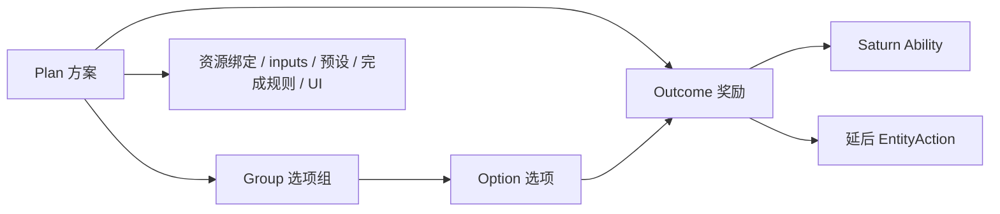

目前是 **3 个独立的数据包注册表：Plan → Group → Option**。资源和能力复用 Saturn；预设、完成规则和奖励内嵌在定义中。



数据包目录对应如下，`<namespace>` 是整合包自己的命名空间：

| 路径 | 内容 |
|---|---|
| `data/<namespace>/spb/plan/<id>.json` | 开局方案 |
| `data/<namespace>/spb/group/<id>.json` | 选项组 |
| `data/<namespace>/spb/option/<id>.json` | 具体选项 |
| `data/<namespace>/tags/spb/group/<id>.json` | 组 tag |
| `data/<namespace>/tags/spb/option/<id>.json` | 选项 tag |
| `data/<namespace>/saturn/resource/<id>.json` | 点数、属性等资源 |
| `data/<namespace>/saturn/ability/<id>.json` | 可授予的能力 |

[Plan](E:/Java/StartingPointBuy/src/main/java/com/iafenvoy/spb/data/Plan.java) 是入口，组织整个加点流程：

| 字段 | 作用 |
|---|---|
| `title` | 可选的界面顶部标题，未配置时不显示 |
| `description` | 可选的方案说明 |
| `activation` | 首次加入自动开启、优先级、开启条件 |
| `inputs` | 会话开始时捕获并保存的外部数值 |
| `resources` | 绑定多个 Saturn resource，设置初值、精度和提交方式，公式别名按资源 ID 自动生成 |
| `presets` | 左栏预设，保存“选项 ID → 数量” |
| `groups` | 按顺序引用组，支持直接 ID 和 `#tag` 混排 |
| `completion_rules` | 完成方案必须全部满足的条件 |
| `outcomes` | 整个方案完成后的奖励 |
| `ui` | 左栏宽度、窗口尺寸、能否提前关闭 |

资源绑定中的 `commit: replace` 在确认后写回最终资源值，`discard` 只参与草稿计算。`initial` 未设置时使用玩家已有资源值。

[Group](E:/Java/StartingPointBuy/src/main/java/com/iafenvoy/spb/data/Group.java) 管选择方式，[Option](E:/Java/StartingPointBuy/src/main/java/com/iafenvoy/spb/data/Option.java) 管单项行为：

| 定义 | 主要配置 |
|---|---|
| Group | `count_mode: distinct/total`、动态 `min_count/max_count`、显示条件、选项引用列表 |
| Option | 名称/描述/图标、固定 `hard_max`、动态 `min_count/max_count`、显示/可用条件、已选校验规则、资源变化、奖励 |

组的选择上限直接由 `max_count` 配置，无需 `mode` 或额外的 `max_choices` 字段。`distinct` 按选项种类计数，`total` 按所有份数之和计数；同一项可重复多少份由 Option 独立控制。

```json
{
  "title": {"text": "天赋"},
  "count_mode": "distinct",
  "min_count": 1,
  "max_count": "2 + selected_example_scholar",
  "options": ["example:archery", "example:alchemy"]
}
```

`max_count: 1` 时，点击新选项会替换旧项；候选选择将公式上限提升至 `2` 或更多时，保留旧项。上限下降导致超限时保留草稿并阻止确认，可手动修正。原 `mode: single` 数据应改为 `max_count: 1`，原 `multiple` 组删除 `mode` 并保留数量配置。

每个选项都有非负整数数量 `q`，`0` 表示未选。资源变化按 **每份变化 × q** 计算。例如 `data/spb_test/spb/option/train.json` 中的训练选项：

```json
{
  "name": {"text": "训练"},
  "hard_max": 4,
  "max_count": "2 + 2 * selected_spb_test_sword",
  "resource_changes": {
    "spb_test:budget": -1,
    "spb_test:power": 1
  }
}
```

每份训练消耗 1 点预算、增加 1 点力量；选择 Sword 后最多购买 4 份，否则最多 2 份。

数值字段使用 Saturn `NumberProvider`，条件使用 `EntityCondition`。资源、组、选项不配置 `key`，统一将完整注册 ID 中的 `:`、`/`、`-`、`.` 替换为 `_`。例如 `spb_test:sword` → `spb_test_sword`，公式读取 `selected_spb_test_sword`。同一方案内同类名称冲突会拒绝整个数据包加载，不按顺序追加后缀。

预设不配置 `key`，按列表顺序自动编号 `preset_1`、`preset_2`……；调整顺序会调整编号。`inputs` 是具名变量映射，仍保留作者配置的名字。Outcome、action 和规则的稳定 `key` 仍保留。

联动公式使用这些变量，其中除 input 外的 `<key>` 均为自动生成的别名：

| 变量 | 含义 |
|---|---|
| `input_<key>` | 捕获的输入值 |
| `base_<key>` | 资源基准值 |
| `selected_<key>` | 某选项的数量 |
| `group_<key>_distinct` | 组内已选种类数 |
| `group_<key>_total` | 组内已选总份数 |
| `resource_<key>` | 计算后的资源余额 |

计算顺序是：**输入/基准 → 选择数量/组计数 → 资源贡献 → 最终余额 → 数量限制和条件**。因此 `resource_changes` 不能读取 `resource_*`，避免余额与价格循环依赖。

`Outcome` 可以放在 Plan 或 Option 中，包含可选条件、能力列表和动作列表。动作配置 `key`、`delay`、`repeat`、`action`；确认时冻结结果，随后授予能力、执行延后动作。

引用层使用：

- 组和选项：`EntryRef<T>`，内部为 `Either<Holder<T>, TagKey<T>>`。
- 资源和能力：`Holder<Resource>`、`Holder<Ability>`。
- 预设选择、存档和网络记录：稳定的 ID。

加载时先经过 Codec 和 Holder 校验，再展开 tag、检查完整方案的引用与变量关系；出现定义错误就拒绝加载世界。GUI 则由服务端计算快照驱动，`ui.allow_close_before_complete` 默认 `false`，打开期间的免伤由服务端统一处理。
